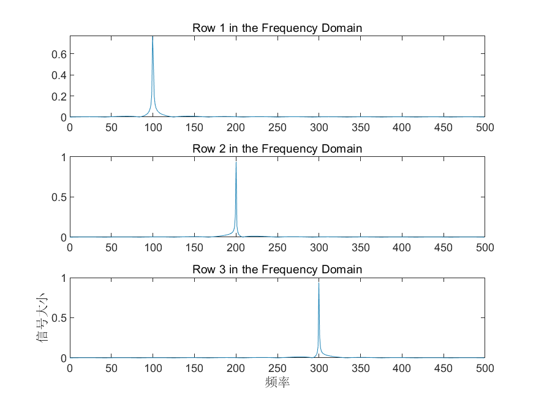
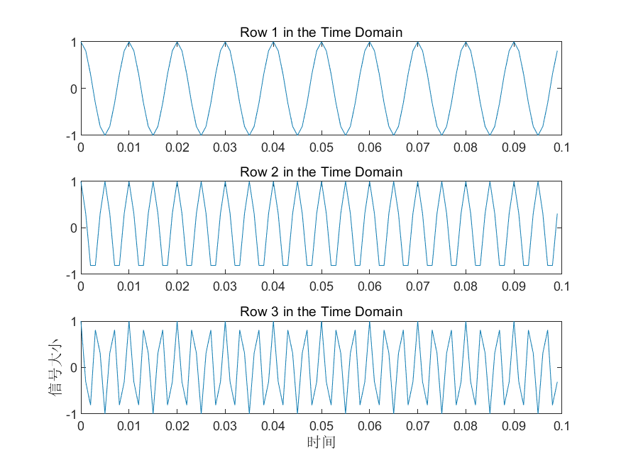

# MATLAB | Spectrum Analysis Algorithm | Fourier Transform | Include data and plotting code | Directly Useable

1. Basic definition: Fourier Transform is a mathematical method used to decompose a signal into a series of sums of sine and cosine functions, thereby facilitating better understanding and processing of signals. The Fourier transform has a wide range of applications in the field of signal processing, including audio processing and image processing. Specifically, the steps of Fourier transform are as follows:
Given a continuous time-domain function f(t), where t is the time.
Perform a Fourier transform on f(t), obtaining its frequency domain representation F(ω), where ω is the angular frequency.
F(ω) represents the amplitude and phase information of all frequency components in f(t).
F(ω) is decomposed into a sum of sine and cosine functions, i.e., F(ω) = ∑[a(k)cos(kω) + b(k)sin(kω)], where k represents the frequency component number, a(k) and b(k) are the corresponding coefficients for sine and cosine functions respectively. The advantage of Fourier transform is that it can convert signals in the time domain into signals in the frequency domain, which helps to better understand the frequency components and periodic characteristics of the signal. It also facilitates some signal processing tasks such as filtering and noise reduction. However, the disadvantage of Fourier transform is that it requires processing the entire signal, which results in a large computational load. In scenarios requiring real-time processing, there may be significant delays.
2 Definition and drawing effect. The following is the drawing effect:
\n        \n  
\n        \n  
Video tutorial operation:
\n        \n          \n          \n          \n          \n            To view this video please enable JavaScript, and consider upgrading to a\n            web browser that\n            supports HTML5 video\n  

## Images

<!-- PAYMENT_BLOCK -->

## Get this dataset

- Payment link (Stripe): [Buy now](https://buy.stripe.com/3cs8yP7sY87d0vu9AB)
- Payment QR code: 

<!-- /PAYMENT_BLOCK -->
